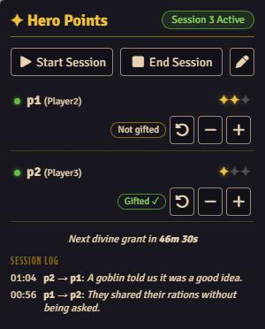
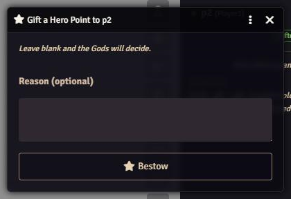
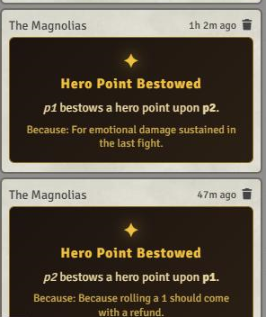

# Hero Point Gifter

A Foundry VTT module for the **Pathfinder 2e** system that adds a **Hero Points** tab to the sidebar.

- **Players** can gift one hero point per session to another player, with an optional reason. Leave the reason blank and the Gods pick a funny one.
- **GMs** start and end sessions, can correct the session number, and can add or remove hero points on any character at any time.
- **Divine grants:** while a session is active, the Gods grant a hero point to random players below their maximum on a timer. The timer is saved in the world, so it survives reloads and a GM going offline.
- The divine grant timer pauses while no players are online and resumes where it left off.
- Everything is posted to chat as themed cards.

## Screenshots

**GM panel** in the sidebar: session controls, hero points per player, gift status and the session log.



**Gift dialog** that players use to gift a hero point. Leaving the reason blank lets the Gods pick one.



**Chat cards** posted when a gift is bestowed.



## Requirements

- Foundry VTT **v14** or newer
- Pathfinder 2e system

## Installation

In Foundry's **Add-on Modules** tab choose **Install Module** and paste this manifest URL:

```
https://github.com/Aalnius/hero-point-gifter/releases/latest/download/module.json
```

Then enable **Hero Point Gifter** in your world's module settings.

## Usage

Open the star-icon tab in the sidebar.

**GM**

| Control | What it does |
| --- | --- |
| Start Session | Starts a new session, gives a point to every online player at 0, and starts the divine grant timer |
| End Session | Ends the session and stops the timer |
| Pencil | Sets the session number if it drifts out of sync |
| + / − | Gives or removes one hero point (the PF2e maximum still applies) |
| Reset arrow | Lets that player gift again this session |

A short reminder toast appears when a GM logs in without an active session. It can be turned off per client in the module settings.

**Players** click the gift icon beside another player. The button is disabled, with a tooltip explaining why, when there is no session, you have already gifted, or the recipient is offline or at the maximum.

## Settings

| Setting | Default | Scope |
| --- | --- | --- |
| Divine Grant Interval (minutes) | 60 | World |
| Players Granted Per Interval | 2 | World |
| Gifts Per Player Per Session | 1 | World |
| End Session When GM Leaves | Off | World |
| Reasons For Divine Grants | On | World |
| Session Start Reminder | On | Client |

## Notes

- A GM must be online for gifts to be processed, since the GM's client applies them.
- The funny gift reasons can be edited in `lang/en.json` under `HPG.FunnyReasons`. Divine grants on the timer pick from those plus the god-themed `HPG.GodReasons`, unless **Reasons For Divine Grants** is off.
- **End Session When GM Leaves** applies the next time a GM loads in with no other GM online, because only a GM's client can end the session. Reloading the page does not end it.

## License

[MIT](LICENSE)
